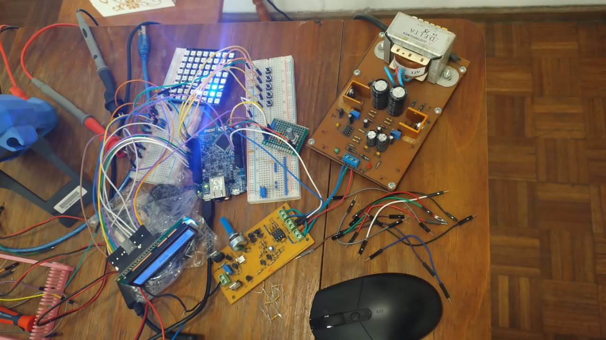
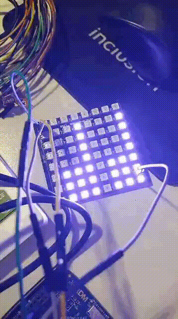

# MP3 Player — FRDM-K64F

Reproductor de MP3 embebido sobre la placa **NXP FRDM-K64F** (Kinetis K64, ARM Cortex-M4F a 120 MHz), desarrollado como Trabajo Práctico Final de **22.99 Laboratorio de Microprocesadores (ITBA, 2022)**.

El equipo lee archivos `.MP3` desde una tarjeta micro SD, los decodifica con la librería **Helix MP3** y reproduce el audio por el **DAC** interno del micro, alimentado por **DMA** y temporizado con el **PIT**. Incluye un ecualizador de 4 bandas basado en CMSIS-DSP, lectura de metadatos ID3v2 y corre sobre el RTOS **µC/OS-III**.

> El enunciado completo está en [Documentation/TPF LaboMicros 2022.pdf](Documentation/TPF%20LaboMicros%202022.pdf).

---

## Demo

### Prototipo



### Vúmetro en la matriz WS2812



---

## Contenido

- [Demo](#demo)
- [Requisitos del TP](#requisitos-del-tp)
- [Hardware](#hardware)
- [Arquitectura del firmware](#arquitectura-del-firmware)
- [Pipeline de audio](#pipeline-de-audio)
- [Ecualizador](#ecualizador)
- [Estructura del repositorio](#estructura-del-repositorio)
- [Compilación y carga](#compilación-y-carga)
- [Estado del proyecto](#estado-del-proyecto)
- [Material de terceros](#material-de-terceros)
- [Autores](#autores)

---

## Requisitos del TP

| Requisito | Descripción | Implementación en el repo |
|---|---|---|
| Lectura de SD | Navegar el FS de una micro SD y leer los MP3 | `SD_Init()` en [source/SD.c](source/SD.c) con FatFs + SDHC |
| Reproducción | Decodificar y reproducir con la mejor calidad posible | Helix MP3 → DMA → DAC0, disparado por PIT a la frecuencia de muestreo |
| Vúmetro / espectro | Matriz de LEDs WS2812 mostrando el espectro | Funciona en el prototipo (ver [Demo](#demo)); pines en [board.h](source/drivers/board.h) (`MATRIZ`), driver no incluido en este repo |
| Control de audio | Play/pausa, siguiente/anterior, volumen en 30 niveles, con encoder y pulsadores | `PauseSong()` / `ResumeSong()`, drivers de encoder y botones; volumen implementado en 20 niveles |
| Ecualizador | Prefijado o ajustable por bandas | 4 bandas (150 Hz, 500 Hz, 1.5 kHz, 4 kHz) con biquads en cascada |
| *Opcional:* ID3 Tag | Leer título, artista, etc. | `Mp3ReadId3V2Tag()` (ID3v2.3 / v2.4: `TIT2`, `TPE1`) |

---

## Hardware

- **FRDM-K64F** — MCU MK64FN1M0VLL12 (1 MB Flash, 256 KB RAM, FPU).
- **Micro SD** — slot integrado de la FRDM, manejado por el periférico SDHC.
- **Salida de audio** — DAC0 de 12 bits (pin `DAC0_OUT`), con offset de media escala (`0x800`).
- **Display LCD 16x2** — modo 4 bits (RS, EN, D4–D7).
- **Encoder rotativo** con pulsador.
- **Pulsadores** PLAY, NEXT y PREV.
- **Matriz WS2812** — prevista para el vúmetro.
- **PCB propia** — diseño en Altium Designer en [Lab_Micros/](Lab_Micros/) (esquemático `Sheet1.SchDoc` y placa `PCB_Micros.PcbDoc`).

### Pinout (de [source/drivers/board.h](source/drivers/board.h))

| Función | Señal | Pin K64F |
|---|---|---|
| LCD | RS | PTD1 |
| LCD | EN | PTD3 |
| LCD | D4 / D5 / D6 / D7 | PTD2 / PTD0 / PTC4 / PTA0 |
| Encoder | A / B / Pulsador | PTC5 / PTC7 / PTC0 |
| Botones | PLAY / NEXT / PREV | PTB23 / PTA1 / PTB9 |
| UART | Tx / Rx | PTC17 / PTC16 |
| Matriz WS2812 | Din / Dout | PTC2 / PTC3 |
| Test / IRQ | — | PTB2 |
| LEDs de la placa | R / G / B | PTB22 / PTE26 / PTB21 |

La documentación de la placa y del micro (esquemáticos, reference manual, datasheet, notas de aplicación) está en [Documentation/](Documentation/).

---

## Arquitectura del firmware

```
main()  ──►  hw_Init()  ──►  OSInit()  ──►  TaskMain
                                              │
                                              ├─ App_Init()  inicializa drivers y semáforos
                                              ├─ crea Task Refresh / Task Live / Task Cloud
                                              └─ loop: App_Run()
                                                    └─ OSPendMulti() sobre los semáforos de
                                                       encoder, botones, mensajes y lector
                                                       → despacha el evento a la FSM
```

- **RTOS:** µC/OS-III (Micrium), con round-robin habilitado. Configuración en [source/ucosiii_config/](source/ucosiii_config/) y port en [source/rtos/uCOSIII/](source/rtos/uCOSIII/).
- **Modelo de eventos:** cada driver de entrada (encoder, botón, mensajes, timers) publica un `OS_SEM`. La aplicación queda bloqueada en `OSPendMulti` hasta que alguno se active y procesa el evento en una máquina de estados.

### Capas

| Capa | Ubicación | Contenido |
|---|---|---|
| Aplicación | `source/App.c`, `source/main.c` | Tareas RTOS y máquina de estados |
| Servicio de audio | `source/SD.c` / `SD.h` | Montaje de la SD, listado de canciones, decodificación, ping-pong buffer, volumen, ID3 |
| Drivers propios | `source/drivers/` | GPIO, PIT, DMA, DAC, ADC, CMP, FTM, UART, SysTick, timers por software, FIFO, LCD, encoder, botones, LEDs, ecualizador |
| Middleware | `fatfs/`, `sdmmc/`, `helix/` | FatFs, stack SD/MMC de NXP, decoder Helix |
| SDK / BSP | `SDK/`, `fsl_board/` | CMSIS, drivers `fsl_*` de NXP, configuración de clocks y pin mux |

### Drivers propios (`source/drivers/`)

| Driver | Descripción |
|---|---|
| `gpio` | API estilo Arduino (`gpioMode`, `gpioWrite`, `gpioRead`, IRQ por pin) |
| `PIT` | Configuración de los timers PIT y callbacks; marca el ritmo de muestreo del audio |
| `DMA` | eDMA + DMAMUX: transferencia de samples al DAC y consulta del major loop (`DMA_GetRemainingMajorLoopCount`) |
| `DAC` | Inicialización, habilitación y DMA del DAC0/DAC1 |
| `ADC`, `CMP`, `FTM` | Periféricos analógicos y FlexTimer (PWM / input capture) |
| `uart` | UART no bloqueante con FIFO por hardware |
| `timer`, `SysTick` | Timers por software sobre SysTick |
| `fifo` | Cola circular genérica |
| `lcd` | LCD 16x2 HD44780 en modo 4 bits |
| `encoder`, `button` | Entradas de usuario con debounce y detección de giro, click, doble/triple click y click largo |
| `leds` | LEDs de estado |
| `equalizer` | Ecualizador paramétrico con CMSIS-DSP |

---

## Pipeline de audio

```
 micro SD ──FatFs──► ping_pong_buffer (16 KB)
                          │  MP3FindSyncWord + MP3Decode (Helix)
                          ▼
                    samples PCM int16 (≤ 2304 por frame)
                          │  mono → estéreo (duplica) si nChans == 1
                          │  ecualizador (opcional, float32)
                          │  volumen (0–20 × 5 %)
                          ▼
                    audio_buff[2 × 2304]   ◄── ping-pong: se llena una mitad
                          │                    mientras el DMA consume la otra
                          ▼
              DMA canal 1 (disparado por PIT a fs) ──► DAC0 ──► salida analógica
```

1. **`SD_Init()`** monta el volumen (`f_mount`), abre `/` y guarda hasta 50 archivos `.MP3` (8.3, 16 caracteres).
2. **`PlaySong(name, volumen)`** se llama de forma repetida. Cada llamada decodifica un frame:
   - Al cambiar de canción, abre el archivo, inicializa el decoder (`MP3InitDecoder`) y lee el tag ID3v2 (título y artista).
   - Si quedan menos de `BUFFER_SIZE/2` bytes, recarga el buffer con `f_read`.
   - Sincroniza con `MP3FindSyncWord` y decodifica con `MP3Decode`.
   - En el primer frame válido configura el PIT a `samprate` y arranca DMA y DAC (`RunDAC`).
3. **`ProvideAudioBuffer()`** aplica ecualizador y volumen, convierte a 12 bits sin signo (`sample / 16 + 2048`) y escribe la mitad del buffer que el DMA no está leyendo.
4. **`PauseSong()` / `ResumeSong()`** detienen o reanudan el PIT y dejan el DAC en media escala.

---

## Ecualizador

Implementado en [source/drivers/equalizer.c](source/drivers/equalizer.c) con `arm_biquad_cascade_df1_f32` (CMSIS-DSP): una cascada de **4 secciones biquad** (orden 8), una por banda.

| Banda | Ganancias disponibles |
|---|---|
| 150 Hz | 0, −3.5, −6, −9 dB |
| 500 Hz | 0, −3.5, −6, −9 dB |
| 1.5 kHz | 0, −3, −6, −9 dB |
| 4 kHz | 0, −3, −6, −9 dB |

- `setUpCascadeFilter("abcd")` recibe un string con un dígito por banda (`'0'` es bypass) y carga los coeficientes precalculados (`b0, b1, b2, a1, a2`).
- `On_Off_equalizer(bool)` lo activa o desactiva en tiempo de ejecución.

---

## Estructura del repositorio

```
MP3-Player-main/
├── source/
│   ├── main.c              # Arranque, µC/OS-III y tareas
│   ├── App.c               # Máquina de estados de la aplicación
│   ├── SD.c / SD.h         # Lectura de SD, decodificación MP3 y salida de audio
│   ├── drivers/            # Drivers propios (ver tabla)
│   ├── rtos/uCOSIII/       # Kernel µC/OS-III, uC-CPU, uC-LIB y BSP
│   ├── ucosiii_config/     # os_cfg.h, os_cfg_app.h, cpu_cfg.h
│   └── tests/LCDtest.c     # Prueba aislada del LCD
├── helix/                  # Decoder MP3 Helix (punto fijo), headers en pub/
├── fatfs/                  # FatFs (ChaN) + glue para SD (fsl_sd_disk)
├── sdmmc/                  # Stack SD/MMC del SDK de NXP
├── SDK/                    # CMSIS, drivers fsl_* y startup del MK64F12
├── fsl_board/              # clock_config, pin_mux, peripherals (MCUXpresso Config Tools)
├── Lab_Micros/             # Proyecto Altium (esquemático y PCB)
├── Documentation/          # Enunciado, manuales de la FRDM-K64F, del K64 y de MCUXpresso
├── uart_check/
│   └── serial_monitor.py   # Monitor serie en hex (pyserial) para depurar
├── .cproject / .project    # Proyecto Eclipse / MCUXpresso
└── MP3-Player PE *.launch  # Configuraciones de debug (Debug / Release)
```

---

## Compilación y carga

### Requisitos

- **MCUXpresso IDE** (NXP), con el toolchain *NXP MCU Tools* (`arm-none-eabi-gcc`).
- SDK de la FRDM-K64F instalado en el IDE.
- Placa FRDM-K64F con firmware OpenSDA (CMSIS-DAP o P&E).

### Pasos

1. *File → Import → Existing Projects into Workspace* y elegir la carpeta del repo. El proyecto se llama `MP3-Player`.
2. Elegir la configuración **Debug** o **Release**. Ya quedan configurados:
   - Símbolos: `CPU_MK64FN1M0VLL12`, `__USE_CMSIS`, `SDK_DEBUGCONSOLE=0`, `DEBUG` / `NDEBUG`.
   - FPU: `fpv4` hard-float.
   - Includes de µC/OS-III, `SDK/`, `SDK/CMSIS`, `SDK/startup` y `source/`.
3. *Build Project*. El post-build imprime el uso de memoria (`arm-none-eabi-size`).
4. Conectar la placa por el puerto **OpenSDA** y lanzar `MP3-Player PE Debug.launch`.

### Tarjeta SD

- Formato **FAT/FAT32**.
- Copiar los `.MP3` en la **raíz**. Los nombres deben estar en mayúsculas: el filtro busca `".MP3"` en el nombre corto.
- Hasta **50** canciones.

### Monitor serie

```bash
pip install pyserial
python uart_check/serial_monitor.py --port COM3
```

Abre el puerto a 1200 baudios y muestra cada byte recibido en hexadecimal.

---

## Estado del proyecto

El repositorio refleja el trabajo **en desarrollo**. Parte del código viene de TPs anteriores de la materia (control de acceso con lector de banda magnética y demodulador FSK) y todavía no está integrado. Puntos conocidos:

- **Aplicación sin integrar:** [source/App.c](source/App.c) todavía tiene la máquina de estados del TP de control de acceso (ID, contraseña, brillo, lector de tarjetas, base de usuarios en `user.c`). `SD_Init()` y `PlaySong()` no se llaman desde ningún lado. Las tareas `Task Cloud`, `Task Live` y `Task Refresh` de `main.c` son stubs.
- **Drivers heredados:** `display` (7 segmentos), `card_reader`, `user` y `message` son de los TPs anteriores y solo los usa `App.c`. `display.c` usa `DIO_15`, que está comentado en `board.h`.
- **Ecualizador:** `SD.c` llama a `offEqualizer()`, que no está definida. `equalizer.h` declara `blockEqualizer()`, `InitVUAnalyzer()` y `VUAnalyze()`, que tampoco están implementadas.
- **`bit_decoder.c`** (demodulador FSK de otro TP) usa una API de DMA distinta de la de [DMA.h](source/drivers/DMA.h) y no compila tal cual.
- **`tests/LCDtest.c`** define `App_Init` / `App_Run` igual que `App.c`. Hay que excluir uno de los dos del build.
- **`PlaySong()`:** en la primera llamada hace `*old_name` con `old_name == NULL`. Hay que inicializarlo o compararlo con `strcmp` después de chequear `NULL`.
- **Conversión mono → estéreo:** el loop arranca en `i = outputSamps`, por lo que escribe `samples[2*outputSamps + 1]`, que queda fuera de `sample_buffer[2304]` cuando `outputSamps = 1152`. Debería arrancar en `outputSamps - 1`.
- **Volumen:** son 20 niveles (el enunciado pide 30). Además solo procesa las muestras pares, así que mezcla los canales y deja intactas las impares.
- **Vúmetro con matriz WS2812:** funciona en el prototipo (ver [Demo](#demo)), pero su driver no está en este repositorio.

---

## Material de terceros

Como pide el enunciado, este es el material externo usado:

| Componente | Origen | Licencia |
|---|---|---|
| Helix MP3 Decoder (fixed-point) | RealNetworks / Helix Community | RPSL / RCSL |
| FatFs | ChaN — http://elm-chan.org/fsw/ff/ | BSD-style |
| µC/OS-III, uC-CPU, uC-LIB | Micrium / Silicon Labs | Apache 2.0 |
| MCUXpresso SDK (CMSIS, drivers `fsl_*`, SD/MMC, startup) | NXP | BSD-3-Clause |
| CMSIS-DSP (`arm_math.h`, biquads) | ARM | Apache 2.0 |
| Drivers `gpio`, `uart`, `timer`, `SysTick`, plantilla `App.c` | Nicolás Magliola (cátedra) | Material de la materia |
| Base de `SD.c` (flujo de reproducción) | [vinodstanur/frdmk64f_mp3_player](https://github.com/vinodstanur/frdmk64f_mp3_player) | — |
| Lectura de ID3v2 | [mikrocontroller.net #252319](http://www.mikrocontroller.net/topic/252319) | — |
| Driver LCD 16x2 | [NXP Community — Driving 16x2 LCD using KSDK](https://community.nxp.com/t5/Kinetis-Software-Development-Kit/Driving-16x2-LCD-using-KSDK-drivers/ta-p/1098903) | — |

---

## Autores

Grupo de 22.99 Laboratorio de Microprocesadores — ITBA:

- **Ignacio Cutignola** — [@cutignolai](https://github.com/cutignolai)
- **Valentino Venier Anache** — [@vvenier](https://github.com/vvenier)
- **Olivia De Vincenti** — [@odevincenti](https://github.com/odevincenti)
